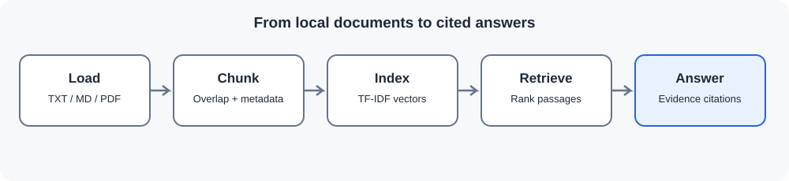

# AI Research Assistant — RAG

A reproducible assistant for searching local TXT, Markdown and PDF documents, retrieving relevant passages, and answering with source references. It runs without a paid API key; an optional OpenAI integration can generate a more natural answer grounded in retrieved passages.

> Scope: bundled files are original demonstration notes, not peer-reviewed research. Add documents you are allowed to use and verify important claims in the cited source pages. This app does not browse the internet.

## Features

- Loads TXT, Markdown and PDF documents from data/documents.
- Splits text into overlapping chunks and preserves file and PDF page labels.
- Uses a local TF-IDF retrieval index powered by scikit-learn.
- Returns ranked passages with citations.
- Provides an extractive answer without an API key, with optional OpenAI answer generation.
- Includes a Streamlit interface and unit tests.

## Workflow



1. Load local documents and source metadata.
2. Split text into overlapping passages.
3. Index the passages with TF-IDF.
4. Retrieve passages relevant to a question.
5. Answer from retrieved context and display the supporting sources.

TF-IDF is a lexical baseline and can miss semantic matches. RAG does not guarantee correctness; users should verify answers against the original material.

## Structure

```text
ai-research-assistant-rag/
├── app.py
├── src/rag_assistant.py
├── tests/test_rag_assistant.py
├── data/documents/
├── figures/01_workflow.svg
├── requirements-llm.txt
└── README.md
```

## Run locally

From the repository root with Python 3.10 or newer:

Windows PowerShell:

```powershell
python -m venv .venv
.\.venv\Scripts\Activate.ps1
pip install -r requirements.txt
python -m unittest discover -s ai-research-assistant-rag/tests -v
streamlit run ai-research-assistant-rag/app.py
```

Linux, macOS or WSL:

```bash
python -m venv .venv
source .venv/bin/activate
pip install -r requirements.txt
python -m unittest discover -s ai-research-assistant-rag/tests -v
streamlit run ai-research-assistant-rag/app.py
```

Add your own TXT, Markdown or text-based PDF files to ai-research-assistant-rag/data/documents/ and refresh the app. Scanned PDFs without a text layer are not OCR-processed.

## Optional OpenAI answer generation

The project works without an API key. To enable generated answers, install the optional dependency:

```bash
pip install -r ai-research-assistant-rag/requirements-llm.txt
```

Windows PowerShell:

```powershell
$env:OPENAI_API_KEY="your-api-key"
$env:OPENAI_MODEL="gpt-4.1-mini"
streamlit run ai-research-assistant-rag/app.py
```

Linux, macOS or WSL:

```bash
export OPENAI_API_KEY="your-api-key"
export OPENAI_MODEL="gpt-4.1-mini"
streamlit run ai-research-assistant-rag/app.py
```

Never commit API keys. API usage may incur charges. With no key configured, the app uses local retrieval and does not send document text to an external service.

## Evaluation and limitations

Tests cover chunking, retrieval, source labels and unsupported questions. TF-IDF scores are ranking signals, not probabilities of correctness. The included notes are demonstrations, not scientific evidence. Review the cited passages before relying on any answer.
