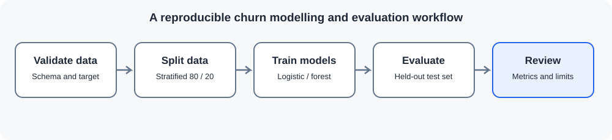

# Customer Churn Prediction

This project examines customer churn patterns in a small sample and compares logistic regression with random forest. It uses a reproducible train/test split, preprocessing pipelines, held-out evaluation metrics and model-specific feature rankings.

> **Data note:** The 600-row dataset is synthetic. It does not represent a real telecom provider or real customers. The results demonstrate a modelling workflow, not a production-ready retention model.

## Questions explored

- What proportion of the sample is labelled as churned?
- How does churn vary across contract type, tenure and service options?
- How do logistic regression and random forest compare on the same held-out customers?
- What do precision, recall, F1-score and ROC-AUC reveal about each model?
- Which features receive the highest model-specific importance scores?

## Workflow



1. Validate the source data and the binary churn target.
2. Split the data into stratified training and test sets.
3. Fit numeric and categorical preprocessing only on training data.
4. Train logistic regression and random forest pipelines.
5. Evaluate on held-out data and export metrics, reports, confusion matrices, ROC curves and feature rankings.

The test set is not used to fit preprocessing or models. Feature rankings are model explanations, not causal effects.

## Tools

Python, pandas, scikit-learn, Matplotlib, SQL and Streamlit.

## Run locally

Run commands from the repository root. Use Python 3.10 or newer.

Windows PowerShell:

```powershell
.\.venv\Scripts\Activate.ps1
pip install -r requirements.txt
python customer-churn-prediction/scripts/run_analysis.py
python -m unittest discover -s customer-churn-prediction/tests -v
streamlit run customer-churn-prediction/app.py
```

Linux, macOS or WSL:

```bash
source .venv/bin/activate
pip install -r requirements.txt
python customer-churn-prediction/scripts/run_analysis.py
python -m unittest discover -s customer-churn-prediction/tests -v
streamlit run customer-churn-prediction/app.py
```

## Outputs

Generated files are written to `customer-churn-prediction/outputs/`:

- `model_metrics.csv`
- Classification reports and confusion matrices for both models
- Model-specific feature rankings
- `churn_by_contract.csv`
- `roc_curves.png`
- `key_findings.md`

These outputs are generated locally and are not committed.

## SQL and dashboard

The queries in [churn_analysis.sql](sql/churn_analysis.sql) provide descriptive summaries by contract, tenure band, support services and payment method. The Streamlit dashboard shows sample-level summaries and model metrics after the analysis has been run.

## Evaluation and limitations

The reported scores depend on this synthetic sample and the chosen split. They are not estimates of performance on real customer populations. Before using this workflow with real data, assess data quality, class imbalance, leakage risks, calibration, subgroup performance, privacy requirements and the operational cost of false positives and false negatives.
