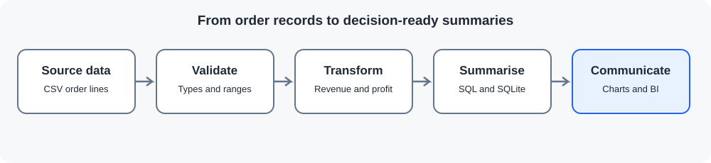

# Sales Performance & Business Intelligence

This project looks at a retail sales dataset from the point of view of a business analyst. The workflow validates order-level data, calculates revenue and profitability, builds SQL-ready summaries, and produces charts for review in Python or Power BI.

> **Data note:** The included 120-row dataset is synthetic. It contains no real customer or company records, and the results are examples of the analysis process rather than claims about a real business.

## Questions explored

- How do revenue and profit change over time?
- Which regions and product categories contribute most to profit?
- How do discounts relate to margin?
- How do sales channels and customer segments compare?
- Which patterns deserve a closer look before a business decision is made?

## Workflow



1. Validate required columns, dates, numeric fields and discount ranges.
2. Calculate gross sales, net revenue, cost, profit and profit margin.
3. Aggregate monthly, regional, category, and channel/segment summaries.
4. Store enriched records in SQLite and create charts and a findings note.
5. Explore the generated tables in SQL, Streamlit or Power BI.

## Tools

Python, pandas, Matplotlib, SQLite, SQL, Streamlit and Power BI.

## Run locally

Run commands from the repository root. Use Python 3.10 or newer.

Windows PowerShell:

```powershell
.\.venv\Scripts\Activate.ps1
pip install -r requirements.txt
python sales-performance-bi/scripts/run_analysis.py
python -m unittest discover -s sales-performance-bi/tests -v
```

Linux, macOS or WSL:

```bash
source .venv/bin/activate
pip install -r requirements.txt
python sales-performance-bi/scripts/run_analysis.py
python -m unittest discover -s sales-performance-bi/tests -v
```

To launch the optional dashboard after the analysis has run:

```bash
streamlit run sales-performance-bi/app.py
```

## Outputs

The script writes files under `sales-performance-bi/outputs/` and `sales-performance-bi/reports/`:

- `sales_enriched.csv` — validated order-level records with calculated measures.
- `monthly_summary.csv`, `region_summary.csv`, `category_summary.csv`, `channel_summary.csv` — tables for reporting.
- `sales_analysis.db` — SQLite database with the enriched `sales` table.
- `monthly_revenue.png` and `profit_by_region.png` — generated charts.
- `key_findings.md` — a run-specific summary of the sample.

Generated outputs are not committed; rerun the script to reproduce them from the source CSV.

## SQL and Power BI

The queries in [analysis.sql](sql/analysis.sql) cover overall, monthly, regional, product, discount-band and channel/segment performance. Run the analysis first so `outputs/sales_analysis.db` exists.

For a Power BI report, follow the [Power BI guide](docs/POWER_BI_GUIDE.md). The repository does not include a prebuilt `.pbix` file.

## Calculation notes

- Gross sales = quantity × unit price
- Net revenue = gross sales × (1 − discount percentage)
- Cost = quantity × unit cost
- Profit = net revenue − cost
- Profit margin = profit ÷ net revenue, when net revenue is non-zero

Taxes, shipping, returns and inventory costs are not modelled. Negative profit is retained rather than removed.

## Interpretation

These summaries are descriptive. They do not establish why a pattern occurred, and the synthetic dataset should not be used to make real pricing, staffing or investment decisions.
